# Petit Rythme 🌙

Application Android pour suivre le rythme de bébé : tétées, biberons, couches, sommeil, soins, croissance.
Pensée pour être utilisée **d'une main, à 3 h du matin** : les gestes fréquents se font en un seul appui.

| Accueil (tétée en cours) | Journal | Rythme sur 24 h | Couche détaillée | Mode nuit |
|---|---|---|---|---|
| 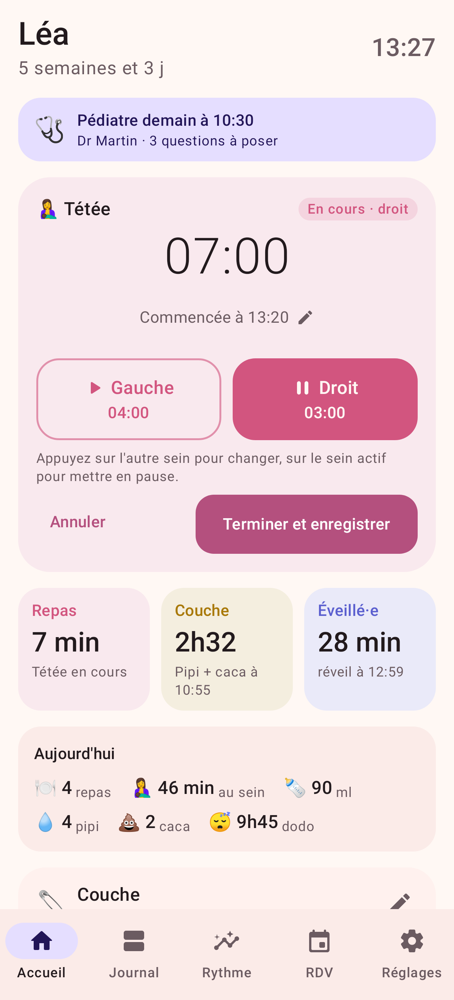 | 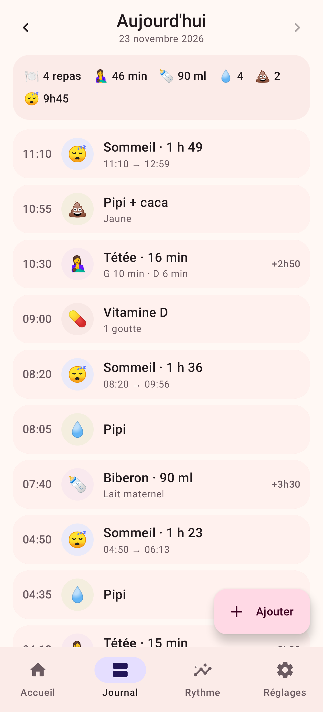 | 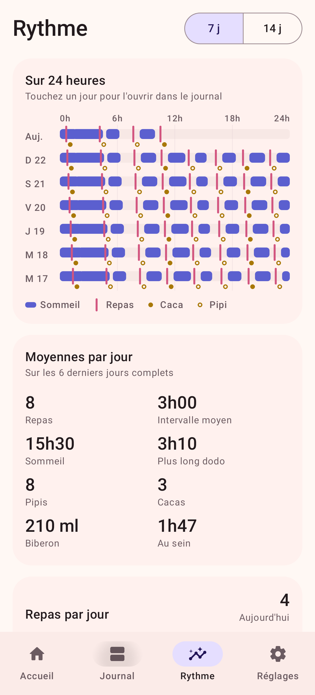 | 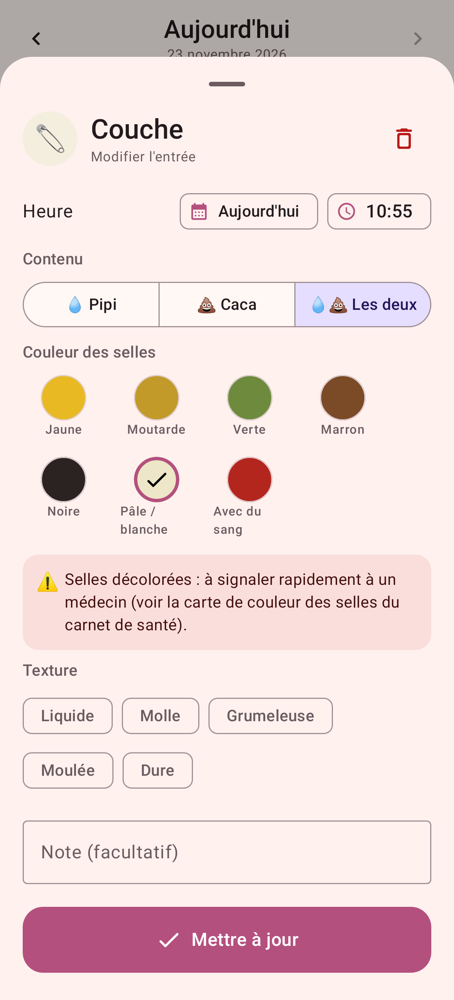 | 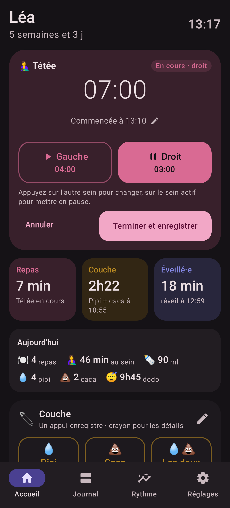 |

### Widget d'écran d'accueil

| Normal | Tétée en cours | Nuit, dodo en cours | Biberon depuis le widget |
|---|---|---|---|
| 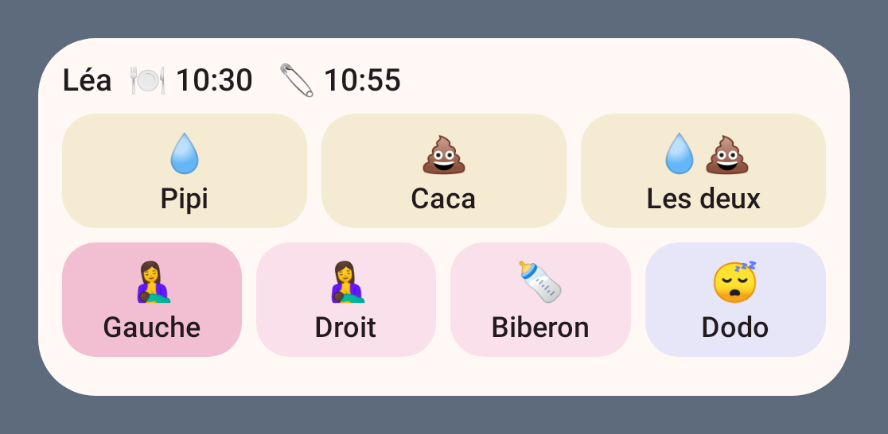 | 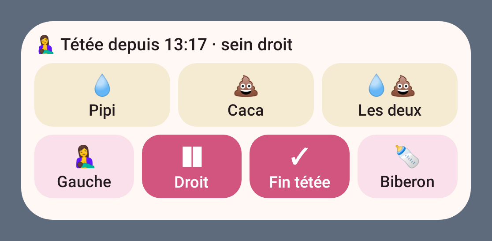 | 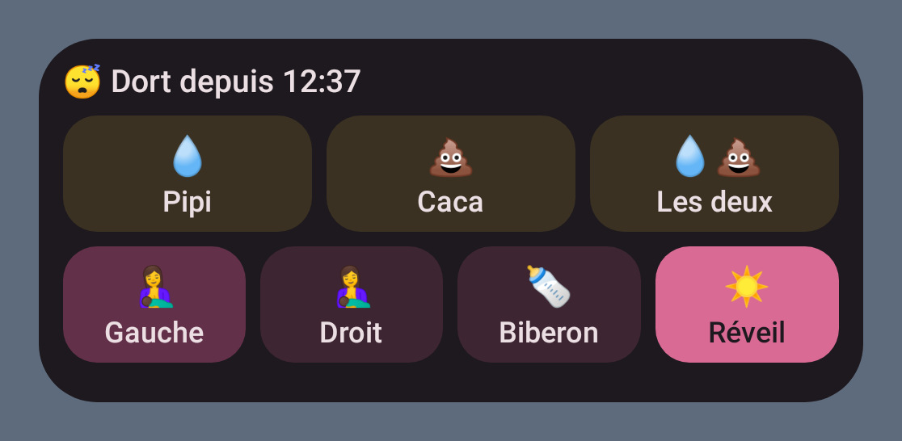 | 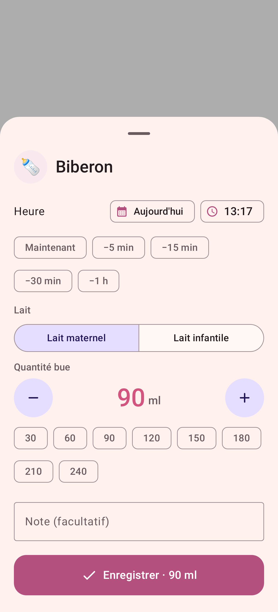 |

### Rendez-vous, vaccins et partage

| RDV et vaccins conseillés | Planifier un vaccin | Fiche RDV | Journal partagé | Réglages du partage |
|---|---|---|---|---|
| 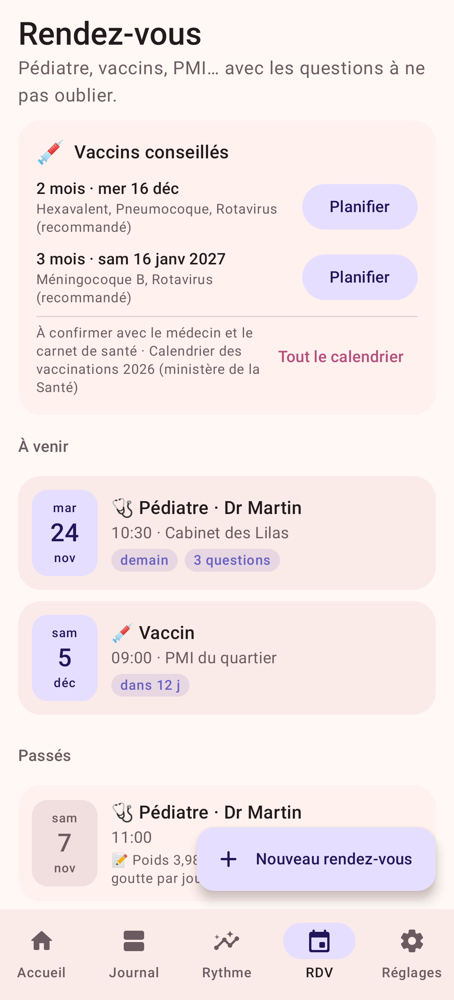 | 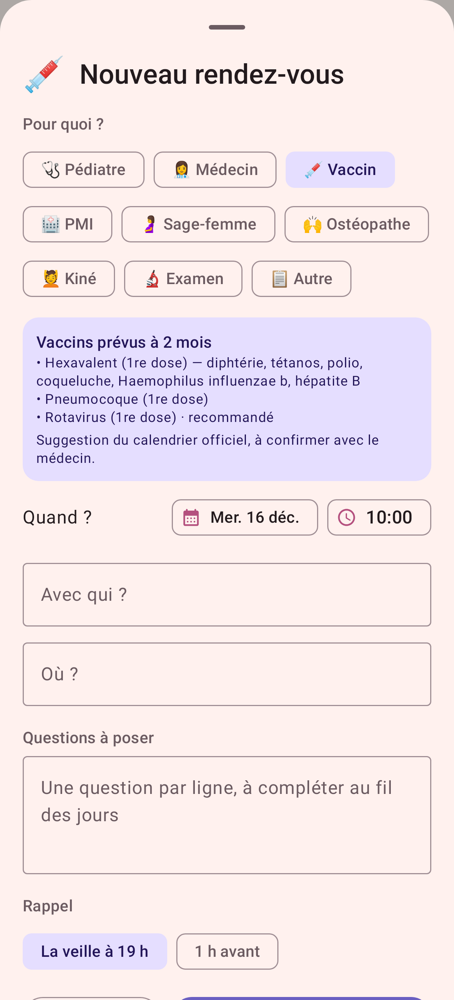 | 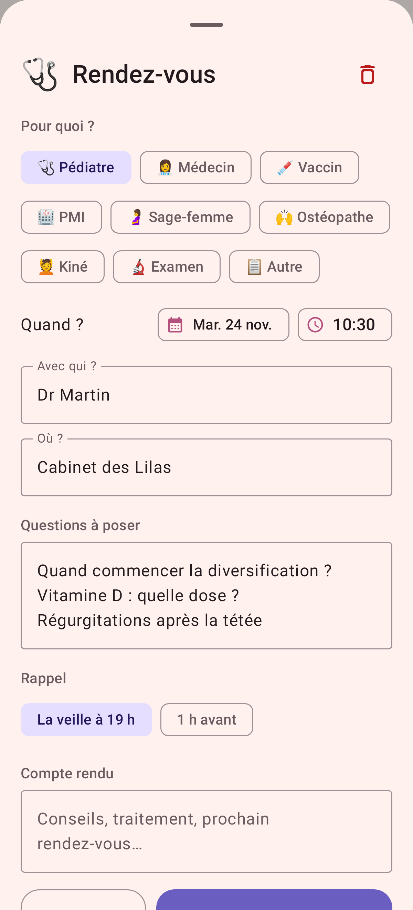 | 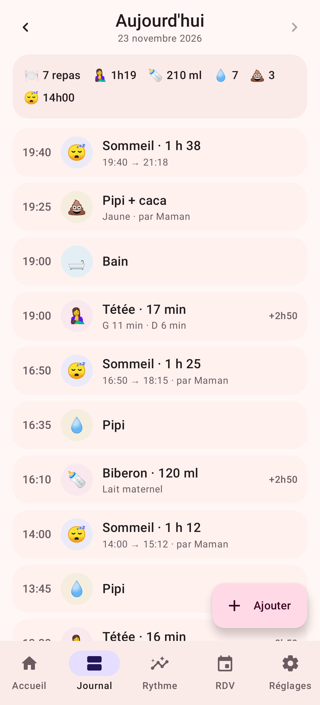 | 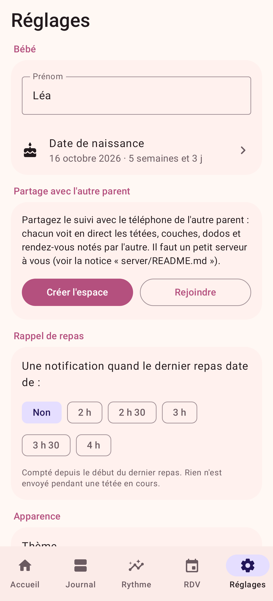 |

## Installer

1. Télécharger [`release/PetitRythme-1.3.apk`](release/PetitRythme-1.3.apk) sur le téléphone.
2. L'ouvrir et autoriser l'installation depuis cette source si Android le demande.

Android 12L (API 32) minimum. Les futures versions s'installent par-dessus sans perdre les données
(même clé de signature, dans `keystore/`).

## Ce que l'appli fait

**Accueil**
- Chronomètre de tétée : un appui sur *Gauche* ou *Droit* le lance. Appui sur l'autre sein pour changer,
  sur le sein actif pour mettre en pause. Le temps est compté par sein, et le sein suivant est suggéré.
- Couche en **un appui** (Pipi / Caca / Les deux), avec *Annuler* dans le message de confirmation.
- Dodo : un appui lance le chrono, *Réveillé·e* l'enregistre.
- « Depuis combien de temps » : dernier repas, dernière couche, éveillé·e depuis.
- Totaux du jour : repas, temps au sein, ml, pipis, cacas, sommeil.
- Les chronos survivent à la fermeture de l'appli et s'affichent dans une notification.
  L'heure de début se corrige si on a lancé le chrono en retard.
- Heure du dernier caca, même si la dernière couche n'était qu'un pipi.

**Widget** (appui long sur l'écran d'accueil → Widgets → Petit Rythme) : Pipi / Caca / Les deux en un appui
avec « Annuler » pendant 10 min, tétée Gauche/Droit (changement, pause, fin), dodo/réveil, et un bouton Biberon
qui ouvre une petite fenêtre pré-remplie avec le dernier biberon. Redimensionnable (version compacte sur une ligne).

**Raccourcis** (appui long sur l'icône de l'appli) : Pipi, Caca, Biberon, Tétée.

**Rappel de repas** (facultatif, dans Réglages) : notification 2 h à 4 h après le début du dernier repas.

**Saisie détaillée** (crayon ✎, ou toucher une entrée du journal) : heure modifiable avec raccourcis
(−5 min, −15 min…), biberon (lait maternel/infantile, quantité avec raccourcis, dernière quantité retenue),
repas solides, tire-lait, couleur et texture des selles (avec alerte selles décolorées / sang, d'après la carte du
carnet de santé), température (alerte fièvre), soins et médicaments (Vitamine D…), bain, éveil,
croissance (poids, taille, périmètre crânien), notes.

**Journal** : jour par jour, résumé en haut, intervalle depuis le repas précédent, balayer pour supprimer
(avec *Annuler*), bouton *Ajouter* pour un oubli, même sur un jour passé.

**Rythme** : vue 24 h sur 7 ou 14 jours (sommeil, repas, couches), moyennes sur les jours réellement suivis
(intervalle réel entre deux repas, plus long dodo…), histogrammes par jour, courbe de poids.

**Rendez-vous** (onglet RDV, à part du suivi quotidien) : pédiatre, vaccins, PMI, sage-femme, ostéo, kiné,
examens… Pour chacun : date, praticien, lieu, **questions à poser** (à compléter au fil des jours), rappel la veille
à 19 h et/ou 1 h avant, compte rendu après la visite. Bouton *Agenda* pour l'ajouter à l'agenda du téléphone
(et le partager avec l'autre parent), et *Noter poids et taille* qui enchaîne sur la saisie de croissance.
Un petit bandeau apparaît sur l'accueil quand un rendez-vous a lieu dans les 3 jours.

**Vaccins conseillés** (dans l'onglet RDV) : d'après le calendrier vaccinal 2026 et la date de naissance,
les deux prochaines étapes (ex. « 2 mois : Hexavalent, Pneumocoque, Rotavirus (recommandé) ») avec
*Planifier*, et le calendrier complet. Ce sont des suggestions, à confirmer avec le médecin.

**Partage avec l'autre parent** (Réglages) : synchronisation via **votre propre serveur** (dossier
[`server/`](server/README.md), Docker, HTTPS automatique en option). *Créer l'espace* sur un téléphone,
*Inviter* (lien à envoyer par SMS/WhatsApp), l'autre parent l'ouvre et rejoint. Journal, rendez-vous,
prénom/naissance et chronos en cours sont partagés ; le journal indique « par Maman / Papa ».
Chaque téléphone garde tout en local et fonctionne hors ligne.

**Réglages** : prénom, date de naissance (âge affiché), thème clair/sombre/auto, sauvegarde et restauration
(JSON, journal et rendez-vous), export CSV pour un tableur ou le pédiatre.

Toutes les données restent sur le téléphone. L'appli ne remplace pas un avis médical.

## Faire vérifier et corriger l'appli par une IA

Voir [`review/README.md`](review/README.md) : prompts prêts à l'emploi (code, UX, design, synchro,
correction + nouvelle build), parcours attendus, décisions volontaires, et `scripts/verify.sh`
qui vérifie tout en une commande. Les règles pour les IA sont dans [`AGENTS.md`](AGENTS.md).

## Développement

Kotlin, Jetpack Compose (Material 3), Room, Glance (widget), WorkManager. Le seul réseau utilisé
est votre serveur de synchro (facultatif).

```bash
scripts/setup-android-sdk.sh     # une fois
scripts/verify.sh                # tests serveur + appli + synchro de bout en bout + APK + contrôles
scripts/release.sh               # publie release/PetitRythme-<version>.apk
```

Les captures sont copiées dans `review/screenshots/`.
